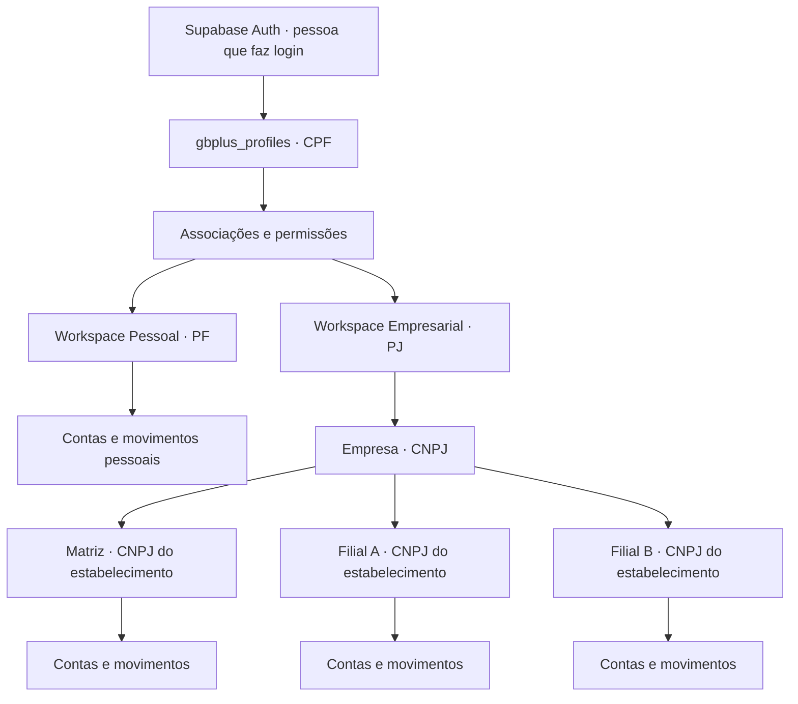

# GB+ — Arquitetura PF/PJ e multiempresa

**Status:** proposta arquitetural para implementação incremental. **Não implanta módulos, tabelas ou regras por si só.**

## Visão

Um único aplicativo e um único login por pessoa natural, com múltiplos ambientes financeiros:

- **GB+ Pessoal (PF):** ambiente privado da pessoa física, identificado por CPF.
- **GB+ Empresas (PJ):** um ambiente por pessoa jurídica (CNPJ); matriz e filiais; múltiplos usuários; consolidação.
- Um usuário humano pode acessar seu ambiente pessoal e várias empresas quando autorizado, **sem mesclar informações**.
- O usuário que só possui ambiente PF não vê navegação, cadastros nem recursos de PJ.

## Regras de identidade

1. `auth.users` continua responsável por e-mail, senha, OAuth Google e sessão. **E-mail pertence à identidade de login, não a cada empresa.**
2. `gbplus_profiles` guarda nome, CPF, telefone, nascimento e endereço. CPF normalizado (11 dígitos), único quando informado, com validação de dígitos verificadores. **Um CPF não deve ser cadastrado em identidades distintas.**
3. CPF validado matematicamente não prova que pertence ao titular: distinguir `cpf_validated_at` de eventual `identity_verified_at`. Definir validação da titularidade antes de tratar como identidade verificada.
4. Após confirmação do CPF, restringir alteração **na base**, não apenas na interface. Correções excepcionais exigem processo administrativo auditado. A tabela de perfil não deve autorizar alteração do próprio CPF bloqueado.
5. E-mail verificado e exclusivo por identidade. Alteração de e-mail fica indisponível no fluxo normal da interface e deve ter política técnica apropriada no Supabase Auth e mecanismo excepcional auditável. Não assumir que desabilitar um input impede chamadas diretas à API do Auth.
6. Google e senha por e-mail devem apontar à **mesma identidade** quando corretamente associados; nunca fundir usuários diferentes nem registros financeiros automaticamente.
7. Dados e permissões empresariais **não devem** residir em `raw_user_meta_data` ou em claims controláveis pelo usuário.
8. LGPD: minimizar coleta, controlar acesso, registrar finalidades e retenção, dar prioridade à proteção de CPF/endereço/nascimento.

## Estrutura proposta de tabelas

| Tabela | Chave/relacionamento | Finalidade |
| --- | --- | --- |
| `auth.users` (existente) | `id` | Login e sessão (Supabase Auth) |
| `gbplus_profiles` | `user_id` → `auth.users.id`; `cpf` UNIQUE | Identidade PF, dados pessoais e estado de bloqueio |
| `gbplus_workspaces` | `id`; `type` = `personal` ou `business` | Fronteira/ambiente de dados financeiros |
| `gbplus_workspace_members` | `workspace_id`, `user_id`, `role`, `status` | Associações explícitas e papéis do usuário |
| `gbplus_companies` | `id`, `workspace_id` UNIQUE, `legal_name` | Cadastro da pessoa jurídica |
| `gbplus_branches` | `id`, `company_id`, `cnpj` UNIQUE | Matriz e filiais da empresa, cada estabelecimento com seu CNPJ |
| `gbplus_member_branch_access` | `member_id`, `branch_id` | Restrições por filial quando aplicável |
| `gbplus_workspace_documents` (transição) | `workspace_id` UNIQUE; `revision`, `data` | Evolução compatível do JSON financeiro atual |
| `gbplus_accounts` (evolução) | `id`, `workspace_id`, `branch_id` opcional | Contas financeiras por ambiente e estabelecimento |
| `gbplus_transactions` (evolução) | `id`, `workspace_id`, `branch_id`, `account_id` | Movimentos financeiros normalizados, audíveis e conciliáveis |
| `gbplus_invites` | `workspace_id`, e-mail convidado, papel, expiração | Convites e aceite de acesso à empresa |
| `gbplus_audit_events` | `workspace_id`, `actor_user_id`, ação, data | Auditoria imutável de operações administrativas e sensíveis |

Relacionamentos: um usuário → um perfil PF; um usuário → um workspace pessoal; um usuário → N vínculos empresariais; uma empresa → N filiais; uma filial → N contas e movimentos. Um workspace empresarial pertence a exatamente uma pessoa jurídica. Distinguir `workspace_id` (separação entre empresas) de `branch_id` (segmentação interna da mesma empresa).

### Política de autorização

- Pessoal: somente o dono do workspace.
- Empresa: papéis iniciais `owner`, `admin`, `finance`, `viewer`. Se necessário, adicionar `manager` e permissões granulares.
- O usuário pode pertencer a múltiplas empresas com papéis distintos.
- Acesso a filial pode ser `all_branches` ou lista explícita autorizada.
- Implementar RLS em todas as tabelas expostas: validar `auth.uid()` + associação ativa + escopo + ação permitida. **Jamais confiar apenas no `workspace_id` enviado pelo frontend.**
- Gravações privilegiadas devem revalidar vínculo, papel, `workspace_id` e `branch_id` no servidor.
- Alterações de papéis, CPF, CNPJ, propriedade e convites devem ser auditadas.
- Não utilizar `user_metadata` ou parâmetro de formulário como autorização.
- Restringir qualquer função `SECURITY DEFINER` e revisar permissões e privilégios do projeto antes de expor novos RPCs.

### Movimentações e relatórios empresariais

- Transações devem possuir ambiente de origem e, em PJ, filial quando aplicável.
- Uma transferência entre duas contas da mesma empresa precisa ser tratada como transferência, não como duas receitas/despesas; evitar dupla contagem no consolidado.
- Relatórios: por filial, por conjunto de filiais ou consolidado da empresa; permissões aplicadas igualmente a consultas, exportações e IA.
- Dados pessoais não entram no consolidado empresarial, mesmo que o usuário tenha acesso a ambos.

## Experiência visual

- PF sem PJ: continua abrindo seu painel habitual, sem seletor aparente.
- PF com acesso PJ: seletor discreto no menu/perfil: `Pessoal`, `Empresa A`, `Empresa B`.
- PJ: submenu `Visão consolidada`, `Matriz`, `Filial A`, `Filial B`; contas e relatórios podem filtrar por filial.
- Cadastro empresarial: pessoa natural entra com CPF/e-mail; depois registra ou recebe convite para empresa, com CNPJ e papel. **Pessoa jurídica não deve ser um usuário técnico compartilhado com senha comum**.
- Primeiro acesso PJ deve ter sequência separada de PF, sem exibir esses passos ao usuário pessoal.

## Compatibilidade e plano de implantação

**Situação atual confirmada em 2026-11-04:** `public.gbplus_documents` utiliza `user_id uuid` como identidade do documento, `revision bigint`, `data jsonb`, `last_operation_id uuid` e `updated_at`. Perfis ficam atualmente nos metadados Supabase Auth. Nenhuma nova tabela foi criada como parte deste desenho.

1. **Etapa A — Identidade PF protegida:** introduzir `gbplus_profiles` com migração aditiva e verificações de conflito de CPF; preservar Auth e os metadados legados durante a transição. Bloquear alterações de CPF no banco após confirmação; definir caminho auditado de correção; política de e-mail segura.
2. **Etapa B — Workspaces transparentes:** criar workspace PF e associação ao dono; migrar cada documento financeiro existente por processo idempotente com backup e validação de revisões. Não eliminar `gbplus_documents` antes de validação e estratégia de rollback.
3. **Etapa C — Modo empresarial:** empresas, filiais, associação de usuários e convites, com controles RLS e testes de isolamento por workspace/filial. Construir interface PJ separada; interface PF permanece igual.
4. **Etapa D — Financeiro multiempresa robusto:** migrar gradualmente documentos JSON a tabelas financeiras normalizadas e compatibilizar relatório, auditoria, transferências, exportações e IA.
5. **Etapa E — Operação e segurança:** homologar perfis e permissões, testando dois usuários e duas empresas, CPF duplicado, acesso negado, convite expirado, troca de workspace e restauração.

**Gate de cada etapa:** backup, migração reversível, testes de isolamento, proteção contra concorrência, validação de dados, plano de retorno e homologação antes da liberação.

## Questões de produto para decidir no momento da implementação

- CPF será obrigatório já no cadastro da conta ou apenas na primeira configuração protegida?
- Quem confirma propriedade do CPF e corrige erro de digitação, e sob qual evidência?
- Cadastro PJ será disponibilizado para todos ou somente para contas habilitadas?
- Filiais terão autorização própria de administradores ou apenas visões restritas por gerente?
- Fluxo de assinatura/preço para PF e PJ (não fazer parte da autenticação).

## Escopo desta decisão

Este documento **apenas prepara a arquitetura**. Não cria tabelas, migra contas, altera e-mail, CPF, permissões ou dados financeiros. Não altera versões publicadas do aplicativo.
